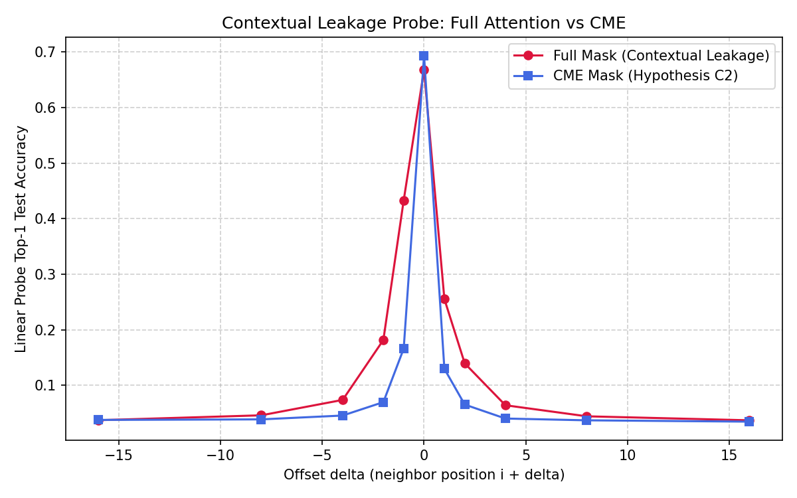
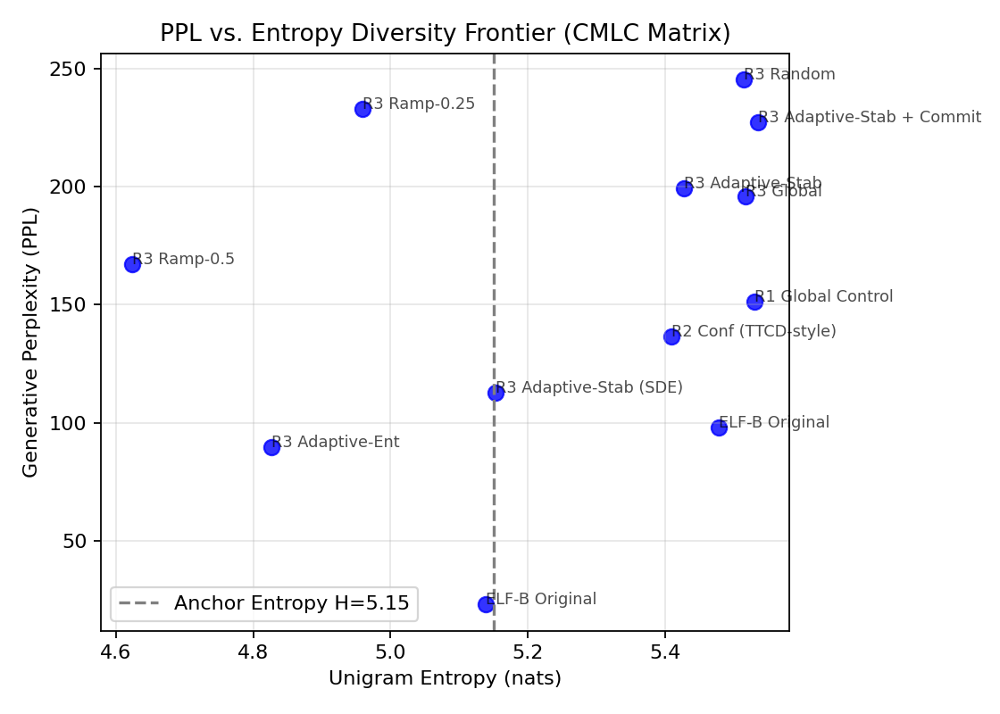

# CMLC Evaluation Report (Milestone 4 / Prompt 2B)

## 1. Main Unconditional Comparison Table

| Row | Method | Policy | Steps | SDE/ODE | Gen-PPL (95% CI) | Entropy | MAUVE | rep-4 | NFE (ELF/Enc) | Delta vs B2 (p-val, Holm) | Delta vs B3 (p-val, Holm) |
|---|---|---|---|---|---|---|---|---|---|---|---|
| B1 | ELF-B Original | global | 32 | sde g1.5 | 22.99 | 5.139 | nan | 0.061 | 34.0/0 | p=0.000 (adj=0.000) | p=0.000 (adj=0.000) |
| B1 | ELF-B Original | global | 16 | ode | 97.90 | 5.478 | nan | 0.016 | 18.0/0 | p=0.000 (adj=0.000) | p=0.000 (adj=0.000) |
| B2 | R1 Global Control | global | 16 | ode | 151.31 | 5.531 | nan | 0.012 | 18.0/0 | Ref | p=0.000 (adj=0.000) |
| B3 | R3 Global | global | 16 | ode | 196.00 | 5.518 | nan | 0.010 | 18.0/0 | p=1.000 (adj=1.000) | Ref |
| B4 | R3 Ramp-0.25 | ramp-0.25 | 16 | ode | 232.84 | 4.960 | nan | 0.014 | 18.0/0 | p=1.000 (adj=1.000) | p=1.000 (adj=1.000) |
| B4 | R3 Ramp-0.5 | ramp-0.5 | 16 | ode | 167.02 | 4.624 | nan | 0.061 | 18.0/0 | p=1.000 (adj=1.000) | p=0.000 (adj=0.000) |
| B5 | R3 Random | random | 16 | ode | 245.33 | 5.515 | nan | 0.005 | 18.0/0 | p=1.000 (adj=1.000) | p=1.000 (adj=1.000) |
| B6 | R2 Conf (TTCD-style) | adaptive-conf | 16 | ode | 136.67 | 5.410 | nan | 0.012 | 82.0/0 | p=0.000 (adj=0.000) | p=0.000 (adj=0.000) |
| Ours | R3 Adaptive-Stab | adaptive-stab | 16 | ode | 199.14 | 5.427 | nan | 0.027 | 18.0/0 | p=1.000 (adj=1.000) | p=0.868 (adj=1.000) |
| Ours | R3 Adaptive-Stab (SDE) | adaptive-stab | 16 | sde g1.0 | 112.84 | 5.152 | nan | 0.029 | 18.0/0 | p=0.000 (adj=0.000) | p=0.000 (adj=0.000) |
| Ours | R3 Adaptive-Ent | adaptive-ent | 16 | ode | 89.76 | 4.827 | nan | 0.035 | 82.0/0 | p=0.000 (adj=0.000) | p=0.000 (adj=0.000) |
| Ours | R3 Adaptive-Stab + Commit | adaptive-stab (proj) | 16 | ode | 227.38 | 5.536 | nan | 0.016 | 23.0/28 | p=1.000 (adj=1.000) | p=1.000 (adj=1.000) |

## 2. Prefix Continuation Table (256-token prefix, 1000 held-out OWT documents)

| Method | Steps | Continuation NLL | Continuation PPL | Prefix-Cont Coherence | MAUVE vs True | rep-4 | NFE |
|---|---|---|---|---|---|---|---|
| ELF-B Inpainting (Baseline) | 16 | 5.148 | 172.05 | 0.709 | 0.019 | 0.055 | 17.0 |
| ELF-B Inpainting (Baseline) | 32 | 4.195 | 66.33 | 0.726 | 0.026 | 0.132 | 33.0 |
| R2 Global | 16 | 4.984 | 146.02 | 0.828 | 0.109 | 0.020 | 17.0 |
| R3 Global | 16 | 5.279 | 196.09 | 0.766 | 0.031 | 0.014 | 17.0 |
| Ours (R3 Adaptive-Stab) | 16 | 5.225 | 185.78 | 0.763 | 0.019 | 0.042 | 17.0 |
| Ours (R3 Adaptive-Stab) | 32 | 5.040 | 154.41 | 0.774 | 0.040 | 0.045 | 33.0 |

## 3. Ablation Table (K=16, seed=0)

| Ablation ID | Policy | CME Km | Time Mode | T | c_max | Gen-PPL | Entropy | rep-4 | NFE |
|---|---|---|---|---|---|---|---|---|---|
| R4 (Km=2) | global | 2 | cont | 1.0 | 0.5 | 151.17 | 5.544 | 0.012 | 17.0 |
| R4 (Km=2) | adaptive-stab | 2 | cont | 1.0 | 0.5 | 170.27 | 5.582 | 0.011 | 17.0 |
| R5 (Km=4) | global | 4 | cont | 1.0 | 0.5 | 149.48 | 5.538 | 0.012 | 17.0 |
| R5 (Km=4) | adaptive-stab | 4 | cont | 1.0 | 0.5 | 163.43 | 5.565 | 0.012 | 17.0 |
| R6 (Noise-Blind) | global | inf | none | 1.0 | 0.5 | 199.22 | 5.548 | 0.009 | 17.0 |
| R6 (Noise-Blind) | adaptive-stab | inf | none | 1.0 | 0.5 | 166.54 | 5.455 | 0.026 | 17.0 |
| R7 (Quant-tau) | global | inf | quant | 1.0 | 0.5 | 195.26 | 5.535 | 0.010 | 17.0 |
| R7 (Quant-tau) | adaptive-stab | inf | quant | 1.0 | 0.5 | 177.91 | 5.454 | 0.022 | 17.0 |
| T=0.5 | adaptive-stab | inf | cont | 0.5 | 0.5 | 175.40 | 5.270 | 0.046 | 17.0 |
| T=2.0 | adaptive-stab | inf | cont | 2.0 | 0.5 | 205.57 | 5.508 | 0.016 | 17.0 |
| c_max=0.25 | adaptive-stab | inf | cont | 1.0 | 0.25 | 199.15 | 5.427 | 0.027 | 17.0 |

## 4. Contextual Leakage Diagnostics

## 5. Diversity Frontier

